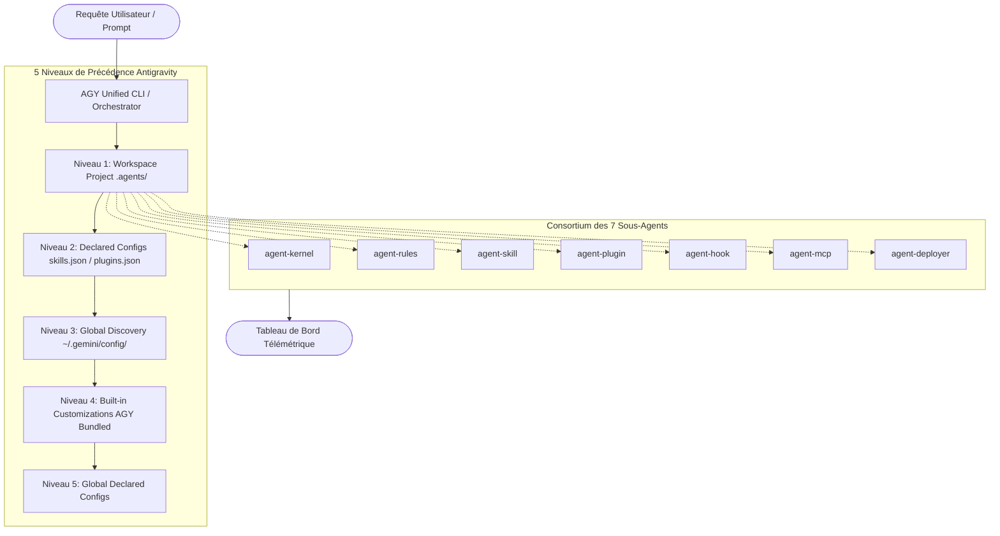

# ⚡ Antigravity Customizations Framework (AGY Customizations v2.0 Enterprise)

[](https://antigravity.google)
[](#matrice-de-tests)
[](https://python.org)
[](LICENSE)

Framework maître d'orchestration, de gouvernance et de déploiement pour l'écosystème **Google Antigravity (AGY)**. Ce système structure et pilote l'ensemble des personnalisations modulaires pour les agents d'ingénierie logicielle : règles hiérarchiques, compétences (skills), modules MCP, intercepteurs de cycle de vie (hooks) et empaquetage de greffons (plugins).

---

## 🏛️ Architecture Globale & Hiérarchie des 5 Niveaux

Le moteur applique un arbitrage déterministe strict basé sur 5 niveaux de précédence :



---

## 🚀 Matrice des Sous-Skills & Sous-Agents

| ID | Composant | Sous-Skill | Sous-Agent | Responsabilité Principale |
| :--- | :--- | :--- | :--- | :--- |
| **01** | **Kernel & Discovery** | `SK-01-kernel-architecture` | `agent-kernel` | Résolution hiérarchique (CWD vers racine Git), gestion de cache et déduplication canonique. |
| **02** | **Rules Engine** | `SK-02-rules-engine` | `agent-rules` | Contrôle strict du budget (20 000 tokens), plafond de 24 Ko/règle et auto-découpage avec `@[]()`. |
| **03** | **Skill Authoring** | `SK-03-skill-authoring` | `agent-skill` | Génération de runbooks procéduraux avec progressive disclosure (`references/`, `scripts/`). |
| **04** | **Plugin Packaging** | `SK-04-plugin-packaging` | `agent-plugin` | Validation du manifeste `plugin.json`, isolation d'espaces de noms et packaging autonome. |
| **05** | **Lifecycle Hooks** | `SK-05-lifecycle-hooks` | `agent-hook` | Interception événementielle sur 6 phases (`PreToolUse`, `PostToolUse`, etc.) avec matchers Regex. |
| **06** | **MCP Integration** | `SK-06-mcp-integration` | `agent-mcp` | Protocoles Model Context Protocol (Stdio & Streamable HTTP 2025-03-26), sécurité et healthcheck. |
| **07** | **Deploy & Validation** | `SK-07-deployment-validation` | `agent-deployer` | Manifestes déclaratifs `skills.json` / `plugins.json`, tests CI/CD et métriques d'intégrité SHA-256. |

---

## 🛠️ CLI Unifiée (`agy_cli.py`)

Le framework dispose d'une interface en ligne de commande complète :

```bash
# Auditer l'espace de travail et calculer le score de conformité
python ./scripts/agy_cli.py audit

# Auto-réparer les non-conformités (frontmatters accidentels, division des règles >24Ko)
python ./scripts/agy_cli.py fix

# Simuler un tour complet de cycle de vie (règles, hooks, routage d'outils)
python ./scripts/agy_cli.py simulate --prompt "Crée une API sécurisée avec tests"

# Échafauder une nouvelle compétence selon les standards AGY
python ./scripts/agy_cli.py scaffold my-new-skill --type skill

# Scanner les modifications pour bloquer toute fuite de secret/clé API
python ./scripts/agy_cli.py git scan

# Générer automatiquement un commit sémantique conventionnel
python ./scripts/agy_cli.py git commit --hint "feat: add neural classifier"

# Générer et mettre à jour le CHANGELOG.md avec calcul de version SemVer
python ./scripts/agy_cli.py git changelog --write

# Gérer les worktrees Git isolés pour les sous-agents
python ./scripts/agy_cli.py git worktree

# Générer le tableau de bord de télémétrie interactif
python ./scripts/agy_cli.py dashboard --open

# Lancer la matrice complète de tests (100% PASS)
python ./scripts/agy_cli.py matrix
```

---

## 📊 Tableau de Bord de Télémétrie

Un tableau de bord HTML/SVG autonome est généré dans `references/telemetry_dashboard.html`, offrant une vue temps réel sur :
- L'état de santé de chaque sous-skill et sous-agent.
- La jauge du budget de tokens (20 000 tokens partagés).
- La structure hiérarchique active.

---

## 📜 Licence
Distribué sous licence MIT.
