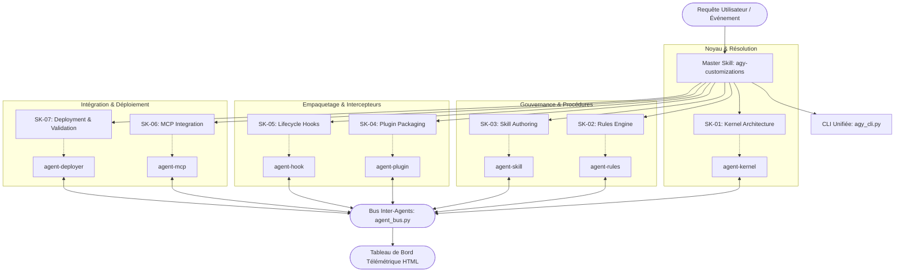

# AGY-CUSTOMIZATIONS — Framework Maître d'Extensibilité Antigravity (v2.0 Enterprise)

Ce skill constitue le framework d'ingénierie et d'orchestration pour le **Système de Personnalisation Antigravity (AGY)**. Il transforme l'assistant généraliste en un système d'ingénierie logicielle hyper-spécialisé, modulaire et auditable, garantissant une conformité stricte avec les spécifications architecturales d'Antigravity.

---

## 1. Architecture Globale et Modèle Opérationnel

Le système repose sur une hiérarchie modulaire articulée autour de **7 piliers d'extensibilité**, chacun couvert par un **sous-skill dédié (SK-01 à SK-07)** et orchestré par un **sous-agent expert (agent-kernel à agent-deployer)** :



---

## 2. Matrice de Routage : Sous-Skills & Sous-Agents

| ID | Domaine / Composant | Sous-Skill | Sous-Agent | Responsabilité Principale |
| :--- | :--- | :--- | :--- | :--- |
| **01** | **Kernel & Discovery** | `SK-01-kernel-architecture` | `agent-kernel` | Résolution hiérarchique, 5 niveaux de précédence, gestion de budget token & déduplication. |
| **02** | **Rules Engine** | `SK-02-rules-engine` | `agent-rules` | Gouvernance `GEMINI.md` / `AGENTS.md`, plafond 24 Ko, budget 20 000 tokens et auto-split `@[]()`. |
| **03** | **Skills Modular** | `SK-03-skill-authoring` | `agent-skill` | Rédaction runbooks procéduraux, frontmatter YAML, divulgation progressive (`references/`, `scripts/`). |
| **04** | **Plugins Bundling** | `SK-04-plugin-packaging` | `agent-plugin` | Manifeste `plugin.json`, isolation d'espaces de noms, staging et activation `config.json`. |
| **05** | **Lifecycle Hooks** | `SK-05-lifecycle-hooks` | `agent-hook` | Interception événementielle `hooks.json` (6 phases clés), filtrage matchers Regex, sandboxing. |
| **06** | **MCP Integration** | `SK-06-mcp-integration` | `agent-mcp` | Protocoles Model Context Protocol (Stdio / Streamable HTTP 2025-03-26), sécurité & outils. |
| **07** | **Deploy & Validation** | `SK-07-deployment-validation` | `agent-deployer` | Manifestes `skills.json` / `plugins.json`, tests CI/CD, hachages SHA-256 et sync GitHub. |

---

## 3. Règles d'Or et Invariants Antigravity

1. **Divulgation Progressive (Progressive Disclosure)** :
   Le fichier racine `SKILL.md` reste synthétique et actionnable. Les détails volumineux, spécifications complètes et schémas sont isolés dans des dossiers `references/`, et les automatisations dans `scripts/`.
2. **Ordre de Priorité Absolu (Precedence Hierarchy)** :
   1. *Workspace Project* (remontée hiérarchique du CWD vers la racine `.git` via `.agents/`, `.agent/`, `_agents/`, `_agent/`)
   2. *Declared Configurations* (`skills.json`, `plugins.json` dans le projet)
   3. *Global Discovery* (`~/.gemini/config/`)
   4. *Built-in Customizations* (compétences intégrées AGY)
   5. *Global Declared Configurations* (`~/.gemini/config/skills.json`, `plugins.json`)
3. **Budget et Plafonds Stricts** :
   - Règles individuelles plafonnées à **24 000 octets** (24 Ko) avec auto-découpage propre via inclusions `@[]()`.
   - Budget cumulé partagé de **20 000 tokens** pour les règles actives (`defaultRulesBudget`). Les règles excédentaires sont rétrogradées en pointeurs de fichiers.
4. **Hooks Non-Bloquants et Sécurisés** :
   - `hooks.json` doit se situer impérativement à la racine du plugin ou du workspace.
   - Gestion stricte des timeouts et capture univoque de `stdout` / `stderr`.
5. **Transports MCP Supportés** :
   - `stdio` (exécutables locaux avec args et variables d'environnement).
   - `Streamable HTTP` (spécification 2025-03-26, point d'entrée HTTP/S `/mcp`). Le transport legacy SSE seul est proscrit.

---

## 4. Outils d'Administration et CLI Unifiée (`agy_cli.py`)

Le script central [`scripts/agy_cli.py`](./scripts/agy_cli.py) offre une suite d'administration complète :

```bash
# 1. Audit complet et calcul du score de conformité (0-100)
python ./scripts/agy_cli.py audit

# 2. Auto-réparation intelligente (frontmatters accidentels, division règles >24Ko)
python ./scripts/agy_cli.py fix

# 3. Simulateur complet de cycle de vie (règles, budget token, hooks, MCP)
python ./scripts/agy_cli.py simulate --prompt "Exemple de prompt"

# 4. Échafaudage intelligent d'une nouvelle ressource
python ./scripts/agy_cli.py scaffold ma-nouvelle-competence --type skill

# 5. Génération du tableau de bord télémétrique HTML interactif
python ./scripts/agy_cli.py dashboard --open

# 6. Exécution de la matrice complète des tests (SK-01 à SK-07)
python ./scripts/agy_cli.py matrix
```

---

## 5. Synchronisation GitHub & CI/CD

- **Synchronisation automatique avec GitHub :**
  ```powershell
  & ./scripts/sync_github.ps1 -RepoName "agy-customizations"
  ```
- **Workflow GitHub Actions :** [`.github/workflows/ci.yml`](./.github/workflows/ci.yml)
- **Tableau de Bord Télémétrique :** [`references/telemetry_dashboard.html`](./references/telemetry_dashboard.html)
- **Bus de communication inter-agents :** [`agents/agent_bus.py`](./agents/agent_bus.py)
